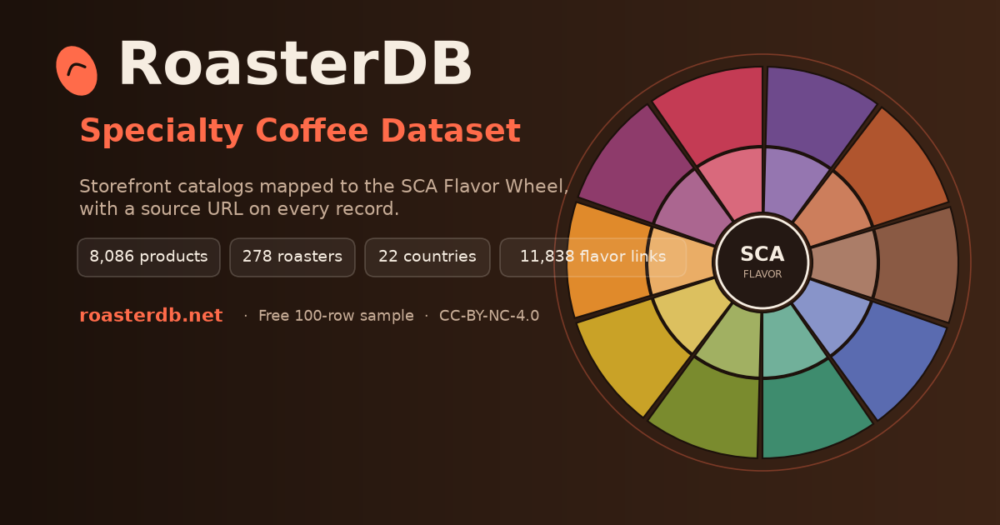

<div align="center">



# ☕ RoasterDB — Specialty Coffee Dataset

**13,000+ specialty-coffee products · 270+ artisan roasters · 20+ countries · mapped to the SCA Flavor Wheel**

[](samples/roasterdb_sample.csv)
[](https://huggingface.co/datasets/Ichlibitiche/roasterdb-specialty-coffee-sample)
[](https://huggingface.co/spaces/Ichlibitiche/dataset-sample-explorers)
[](#whats-inside)
[](CHANGELOG.md)
[](https://roasterdb.dataengineered.io)

**[→ Get the full dataset at roasterdb.dataengineered.io](https://roasterdb.dataengineered.io)**

**Free sample:** [100 rows](samples/roasterdb_sample.csv) · **Full dataset: $49 one-time** → [Buy on Stripe](https://buy.stripe.com/8x2eVe2gU730fUf96w38405)

**Same sample on [Hugging Face](https://huggingface.co/datasets/Ichlibitiche/roasterdb-specialty-coffee-sample)** · **[Kaggle](https://www.kaggle.com/datasets/dataengineered/roasterdb-specialty-coffee-sample)**

</div>

---

A structured dataset of specialty-coffee products scraped from the **direct storefronts** of curated artisan roasters worldwide, with tasting notes normalized to the **Specialty Coffee Association (SCA) Flavor Wheel** and a **source URL on every record** so any fact can be re-verified.

This is a **storefront catalog + flavor-mapping** dataset — strong on roaster breadth, product identity, pricing, and SCA flavor structure. It is **not** a farm-provenance dataset; the honest [field-coverage table](#field-coverage) below shows exactly what is and isn't populated. No hype — just what's in the box.

## What's inside

| | Full dataset | Free sample |
| :--- | ---: | ---: |
| Coffee products | **13,000+** | 100 |
| Artisan roasters | **270+** | 72 |
| Countries (roaster HQ) | **20+** | — |
| SCA flavor mappings | **22,000+** | ~250 |
| Formats | SQLite · CSV · JSON | CSV |

The free [`samples/roasterdb_sample.csv`](samples/roasterdb_sample.csv) is 100 verified-tier records across 72 roasters — a real taste of the schema and quality. Explore it interactively in the [🤗 Sample Explorer](https://huggingface.co/spaces/Ichlibitiche/dataset-sample-explorers), or load it straight from the [🤗 sample dataset](https://huggingface.co/datasets/Ichlibitiche/roasterdb-specialty-coffee-sample). The full dataset is available at **[roasterdb.dataengineered.io](https://roasterdb.dataengineered.io)**.

## Field coverage (the honest numbers)

Measured on 2026-11-07 across all 13,670 records of the 2026.11 edition: the share of records with a non-empty value. Published up front so you can decide if the fields you need are covered — not every coffee lists every attribute on its storefront.

| Field | Coverage | | Field | Coverage |
| :--- | ---: | --- | :--- | ---: |
| Title / product ID | 100% | | Process method³ | 60% |
| Weight² | 96% | | Roast level³ | 34% |
| Price (store currency, sanitized)¹ | 98% | | Varietals | 40% |
| ≥1 SCA flavor node | 64% | | Origin region | 27% |
| Origin country | 73% | | Altitude (masl) | 21% |

¹ Each price is in its store's own currency (`price_currency`: USD, GBP, EUR, AUD, CAD, ZAR, …), read from the store; the 4 records of the one store whose currency could not be read carry no price. Until 2026-10 every price was labelled USD, including the roughly half sold by non-US stores. See [DATA_DICTIONARY.md](DATA_DICTIONARY.md).
² A listing that states no weight leaves it empty (539 records). Until 2026-10 such a listing was recorded as 250 g; 263 of the 1,999 records with 250 were last retrieved before that change (2026-10-02), so theirs may be a default.
³ Only a specific value counts: `process_method` is `Other` and `roast_level` is `Unknown` when the listing doesn't say.

**Two quality tiers** (both in the full dataset):
- **Full catalog** — all **13,000+** records (maximum breadth).
- **Verified tier** — **6,500+** records flagged `good`: origin + sanitized price + SCA flavor mapping, QA-passed.

### SCA flavor mapping — the differentiated part
- **8,500+ coffees** mapped to the SCA wheel · **22,000+** bean→flavor links · avg **2.6** descriptors each.
- All **51** taxonomy descriptors exercised; tasting notes become hierarchical paths, e.g. `Fruity > Other Fruit > Peach`.

## Statistics page (`/stats/`)

[roasterdb.dataengineered.io/stats/](https://roasterdb.dataengineered.io/stats/) publishes aggregate statistics computed from the **full** snapshot — origin shares, SCA flavor families and top descriptors, processing methods, roast levels, median prices per 250 g and the Gesha premium, growing elevations, roaster locations, varietals — as a citable page with embeddable SVG charts and a machine-readable `stats/data.json`. The figures and charts are **CC BY 4.0**: reuse them with a link to the page. Only aggregates are published; the row-level data stays in the commercial dataset.

`scripts/generate_stats.py` regenerates `stats/` from the private pipeline's SQLite after each data refresh (see the private repo's RELEASING.md); follow it with `generate_seo_pages.py` (sitemap) and the i18n `build` + `check`.

## Provenance

Every record is traceable and re-verifiable:

| Field | Meaning |
| :--- | :--- |
| `source_roaster` | Roaster brand |
| `source_url` | Exact product page the data came from |
| `source_platform` | `shopify` |
| `retrieved_at` | Crawl timestamp |
| `dataset_version` | Snapshot id (`2026.07`) |

See [`DATA_DICTIONARY.md`](DATA_DICTIONARY.md) for every field.

## Pricing

| Tier | What | Price |
| :--- | :--- | :--- |
| **Sample** | 100 verified rows (this repo) | Free |
| **Snapshot** | Full 13,000+ records · SQLite + CSV + JSON | **$49** one-time |
| **Custom work** | Subsets, recurring feeds, schema mapping — quoted per engagement | from $99, via the [contact form](https://roasterdb.dataengineered.io/#support) |
| **Live scrape** | On-demand, self-serve via Apify | pay-per-result |

**[→ Get it at roasterdb.dataengineered.io](https://roasterdb.dataengineered.io)** · or use the [contact form](https://roasterdb.dataengineered.io/#support) (roasterdb@dataengineered.io) for custom work.

> 🔄 **Prefer live, self-serve scraping?** Run the [Specialty Coffee Roaster Scraper on Apify](https://apify.com/dataengineered/specialty-coffee-roaster-scraper) — pay-per-result, fresh data on demand.

## Use cases

- Coffee subscription & recommendation apps (structured product + flavor data)
- Flavor-based search and discovery on the SCA graph
- ML / RAG corpora over specialty coffee
- Market & assortment research across roasters, origins, and price bands

## Quick look

```python
import csv
rows = list(csv.DictReader(open("samples/roasterdb_sample.csv", encoding="utf-8")))
print(len(rows), "coffees from", len({r["source_roaster"] for r in rows}), "roasters")
# → 100 coffees from 72 roasters
```

A fuller example is in [`examples/load_sample.py`](examples/load_sample.py).

## License

- **Sample data & docs in this repo:** CC-BY-NC-4.0 — free to use with attribution, non-commercial (see [`LICENSE`](LICENSE)).
- **Full dataset:** commercial license, available at [roasterdb.dataengineered.io](https://roasterdb.dataengineered.io). Distributed as derived factual attributes with source attribution.

Are you a roaster and want a record corrected or removed? Use the [contact form](https://roasterdb.dataengineered.io/#support) or write to roasterdb@dataengineered.io.
